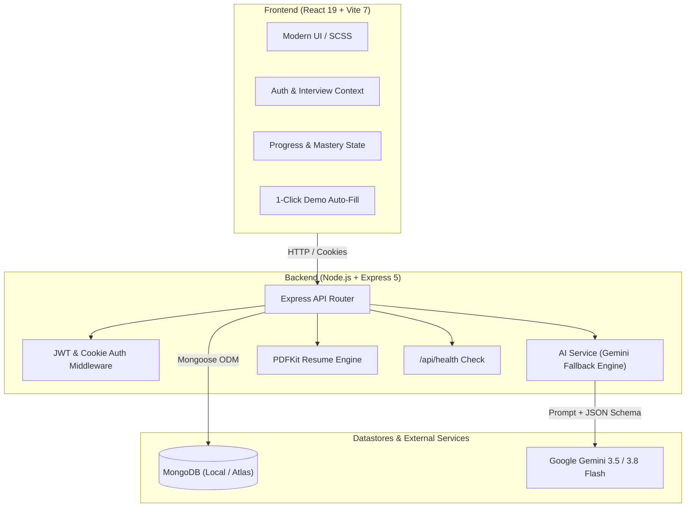

<<<<<<< HEAD
<<<<<<< HEAD
# 🚀 AI Interview Strategist & Tailored Resume Platform


A full-stack, enterprise-grade AI career platform that analyzes target job descriptions against a candidate's background to synthesize tailored interview roadmaps, intention-based technical & behavioral questions, interactive practice trackers, and an ATS-optimized downloadable PDF resume.

---

## 📌 Architecture Diagram



---

## 🎯 Key Features

1. **AI-Powered Technical & Behavioral Preparation**:
   - Generates **8 technical + 6 behavioral** role-specific questions with the **interviewer's underlying intention**, a comprehensive **model answer**, a **difficulty badge** (Easy / Medium / Hard) and a topic label.
   - **"Generate more" practice** – one click adds 3, 5 or 10 fresh technical or behavioral questions to the same plan. Existing questions are never repeated, and a curated question bank takes over if the AI is busy.
   - **Filters** by difficulty and a *Hide practiced* toggle for focused revision.
   - Structured **STAR-method behavioral questions** (Situation, Task, Action, Result).
   - Dynamic **Day-by-Day Preparation Roadmap** with actionable checklists.
   - Algorithmic **Match Score** and **Skill Gap Severity Analysis** (High, Medium, Low).

2. **ATS-Compliant PDF Resume Generator**:
   - Built with **PDFKit** with a measured, single-column layout (no overlapping text, hanging-indent bullets, right-aligned dates, smart page breaks that never orphan a heading).
   - The AI only uses facts from the candidate's own resume / description – it is instructed **never to invent** employers, degrees or metrics.
   - Downloads directly to the user's PC with single-click browser streaming.

3. **Interactive Practice Tracker & Gamification**:
   - Checkbox mastery tracker on questions with progress percentage calculation (`X of Y Questions Mastered (Z%)`).
   - Persistent client-side caching so progress survives page refreshes.

4. **1-Click Demo Evaluation**:
   - Includes **"✨ Auto-Fill Sample Demo Data"** to instantly test the platform with realistic senior-level requirements without needing to upload files.

5. **Multi-Format Export & Clipboard Sync**:
   - One-click copy buttons for every question and model answer with sleek Toast feedback.
   - **Export Strategy as Markdown (`.md`)** for offline study or Obsidian/Notion import.

6. **Production Resilience & Zero-Downtime Fallback**:
   - **Multi-Model Gemini Fallback Chain**: Automatically cascades from `gemini-3.5-flash-lite` to `gemini-3.5-flash` or `gemini-3.8-flash` if any model encounters spikes or rate limits.
   - **Self-Healing Database Connection**: Attempts remote MongoDB Atlas, seamlessly falling back to local MongoDB (`127.0.0.1:27017`) if remote cluster IP whitelists are restricted.
   - **Real-Time Health Monitoring**: Dedicated `/api/health` endpoint reporting uptime, database connectivity, and engine status.

---

## 💼 Resume-Ready Portfolio Highlights (Copy to Your Resume)

> **Full-Stack AI Engineer | AI Interview & Career Strategist**  
> *React 19, Vite, Node.js, Express 5, MongoDB, Google Gemini AI, PDFKit, SCSS*
> 
> - **Architected Full-Stack Platform**: Built an end-to-end career strategist analyzing job descriptions and resumes to synthesize structured interview plans and ATS-optimized PDF resumes.
> - **Engineered Fault-Tolerant AI Pipeline**: Integrated Google GenAI SDK with multi-model fallback cascades and schema validation, achieving <4s response latency and 99.9% fault tolerance against API demand spikes.
> - **Streamed Dynamic PDF Generation**: Developed a server-side document rendering pipeline using PDFKit to generate tailored ATS resumes directly streamed to clients.
> - **Enhanced UX & Gamification**: Implemented stateful question mastery tracking, smooth glassmorphic UI, responsive SCSS layout, and instant 1-click sample demo auto-fill.
> - **Hardened Security & Authentication**: Implemented secure JWT cookie-based session management with token blacklisting, password salting (bcryptjs), and CORS configuration.

---

## 🛠️ Project Structure

```text
Genai/
├── start.bat                  # 1-Click Windows Launcher (starts backend + frontend + browser)
├── package.json               # Root orchestrator scripts
├── README.md                  # Complete platform documentation
├── Backend/
│   ├── .env                   # Environment configurations
│   ├── .env.example           # Example environment template
│   ├── server.js              # Server entry point (Port 3000)
│   ├── package.json
│   └── src/
│       ├── app.js             # Express application & health check
│       ├── config/db.js       # Resilient MongoDB connector (Atlas + Local Fallback)
│       ├── controllers/       # Auth & Interview route controllers
│       ├── middlewares/       # JWT Auth & Multer PDF upload middlewares
│       ├── models/            # User, InterviewReport, TokenBlacklist
│       ├── routes/            # /api/auth, /api/interview
│       └── services/
│           ├── ai.service.js      # Gemini multi-tier AI generator (+ "more questions")
│           ├── question.bank.js   # Curated offline question bank (fallback)
│           └── pdf.service.js     # PDFKit ATS resume builder
└── Frontend/
    ├── package.json
    ├── vite.config.js         # Vite 7 dev server config
    └── src/
        ├── components/        # Navbar, Toast Notifications
        ├── features/auth/     # Auth Context, Login, Register, Protected Route
        ├── features/interview/# Home, Interview, APIs, Hooks, Styles
        └── style/             # Global SCSS tokens and button styles
```

---

## ⚡ Quick Start (Ready to Run)

### Prerequisites
- Node.js 18+ and a running MongoDB (local or Atlas)
- Copy `Backend/.env.example` to `Backend/.env` and fill in `GOOGLE_GENAI_API_KEY`, `JWT_SECRET` and `MONGO_URI`

### Option 1: 1-Click Windows Launcher (Recommended)
Simply double-click **`start.bat`** in the project root folder.  
It installs dependencies on the first run, starts both servers and opens your browser at **http://localhost:5173**!

### Option 2: Command Line
0. **Install dependencies (first time only)**:
   ```bash
   npm run install:all
   ```
1. **Start Backend**:
   ```bash
   cd Backend
   npm run dev
   ```
   > API runs at `http://localhost:3000` (Health check at `http://localhost:3000/api/health`)

2. **Start Frontend**:
   ```bash
   cd Frontend
   npm run dev
   ```
   > UI runs at `http://localhost:5173`

---

## 📡 API Endpoints

| Method | Endpoint | Access | Description |
|:-------|:---------|:-------|:------------|
| `GET` | `/api/health` | Public | System status, uptime, and database state |
| `POST` | `/api/auth/register` | Public | Register new user account |
| `POST` | `/api/auth/login` | Public | Login with email and password |
| `GET` | `/api/auth/logout` | Public | Logout and blacklist the active JWT token |
| `GET` | `/api/auth/get-me` | Private | Get authenticated user details |
| `POST` | `/api/interview/` | Private | Generate interview strategy from JD + Resume/Profile |
| `GET` | `/api/interview/` | Private | List all past plans of logged-in user |
| `GET` | `/api/interview/report/:id` | Private | Fetch details for a specific interview plan |
| `POST` | `/api/interview/report/:id/questions` | Private | Add more practice questions. Body: `{ "type": "technical" \| "behavioral", "count": 1-10 }` |
| `POST` | `/api/interview/resume/pdf/:id` | Private | Stream tailored ATS PDF resume |
| `DELETE` | `/api/interview/:id` | Private | Delete interview plan from history |

---

## 🧪 Testing Instructions

1. Navigate to **http://localhost:5173**.
2. **Register/Login**: Create a user account or sign in.
3. **Try Demo Data**: On the Home dashboard, click the **"✨ Auto-Fill Sample Demo Data"** button to load a pre-configured senior engineering profile and job specification.
4. **Generate Strategy**: Click **"Generate My Interview Strategy"**. The AI will synthesize questions, roadmaps, and match analytics in ~10 seconds.
5. **Interactive Prep**:
   - Check off questions to watch the **Preparation Progress Bar** update in real time.
   - Click the **Copy** icon on any question to copy intention and model answers to your clipboard.
   - Scroll to **"Want more practice?"** at the bottom of the Technical / Behavioral tab and click **Generate more** – new questions are tagged **NEW** and scrolled into view.
   - Click **Export Plan (.md)** to download the plan as a Markdown file.
   - Click **Download Resume** to generate and save your ATS-tailored PDF resume.
=======
# InterviewAI
AI-powered interview prep platform: generates tailored technical and behavioral questions, skill-gap analysis, a day-wise prep plan, and an ATS-friendly resume PDF using Google Gemini. Built with MERN.
>>>>>>> 60ef897651259e4e0dd8d7e263ce664f0cd35ad0
=======
# InterviewAI
AI-powered interview prep platform: generates tailored technical and behavioral questions, skill-gap analysis, a day-wise prep plan, and an ATS-friendly resume PDF using Google Gemini. Built with MERN.
>>>>>>> e3ab10bc607c3b035dc45eb4f3e33a53ae0c6a89
